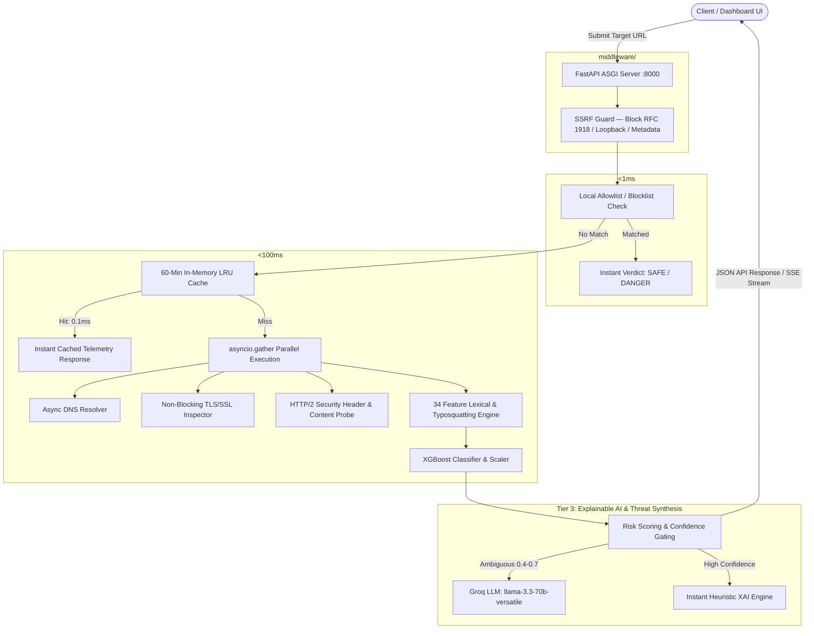

# 🛡️ PhishShield AI 2.0 — Real-Time Threat Intelligence Platform

**PhishShield AI 2.0** is a cybersecurity platform designed for high-throughput, sub-150ms phishing detection and explainable threat intelligence. Powered by an asynchronous FastAPI backend, parallel socket forensic probes, a high-accuracy **XGBoost Classifier**, and Groq LLM-assisted threat explainability.

---

## 📐 System Architecture



---

## 🔥 Key Features

### 1. ⚡ High-Speed Async Scanning Engine (<150ms Target, 0.1ms Cache Hits)
- **Parallel Forensics Pipeline**: Concurrently probes DNS (`socket`/`aiodns`), SSL/TLS certificate chains, and HTTP/2 headers with connection pooling.
- **In-Memory LRU Cache (60-Min TTL)**: Instant `<10ms` response for repeat queries.
- **CDN Profile Acceleration**: Pre-cached IP profiles for known cloud hosts (Vercel, Cloudflare, Netlify, GitHub Pages).

### 2. 🎯 Multi-Tier "Smart Scan" Verdict Engine
- **Tier 1 (Instant, <1ms)**: Local domain allowlist and blocklist resolution.
- **Tier 2 (Parallel, <100ms)**: 34-feature extraction + XGBoost Classifier.
- **Tier 3 (Deferred / Conditional)**: Groq LLM invoked conditionally for ambiguous cases, streamable via Server-Sent Events (`POST /api/scan-stream`).

### 3. 🛡️ Security Boundary Hardening
- **SSRF Guard (`middleware/ssrf_guard.py`)**: Blocks RFC 1918 private IPs, loopback, link-local (AWS/GCP metadata `169.254.169.254`), multicast, CGNAT, and private IPv6 ranges.

### 4. 📊 Scientifically Valid ML Evaluation Suite (`ml/`)
- **Domain-Aware & Temporal Splitting (`ml/temporal_split.py`)**: Prevents domain leakage across train/test sets using eTLD+1 grouping.
- **Comprehensive Metrics (`ml/metrics_suite.py`)**: Accuracy, Precision, Recall, F1, PR-AUC, ROC-AUC, and Enterprise SaaS-specific False Positive Rate (FPR).
- **CLI Evaluation Runner (`ml/evaluate.py`)**: Automated test execution and JSON reporting.

---

## 🛠️ Technology Stack

| Layer | Technology |
| :--- | :--- |
| **Backend ASGI Framework** | Python 3.13, FastAPI, Uvicorn |
| **Async Networking & HTTP/2** | `httpx[http2]`, `h2`, `aiodns`, `pyOpenSSL` |
| **Machine Learning Inference** | XGBoost, StandardScaler (`scikit-learn`, `joblib`, `numpy`) |
| **Generative Threat AI** | Groq API (`llama-3.3-70b-versatile`) |
| **Security Middleware** | SSRF Guard (RFC 1918 / Cloud Metadata Interceptor) |
| **Frontend UI** | Glassmorphism CSS3, Vanilla ES6+, Chart.js |
| **Testing Suite** | Pytest, Pytest-Asyncio (42/42 Automated Unit Tests) |

---

## 📁 Project Directory Structure

```text
phishing/
├── api/                   # FastAPI async route controllers
│   ├── __init__.py
│   └── async_routes.py    # High-speed async scan & analytics endpoints
├── core/                  # Security engine & forensics
│   ├── async_scanner.py   # Parallel DNS, SSL, and HTTP/2 inspection
│   ├── scanner.py         # 34-feature extraction
│   └── verdict.py         # Multi-tier classification logic
├── data/                  # Blocklist & sample dataset
├── middleware/            # Security boundary guards (SSRF Guard)
├── ml/                    # Scientifically sound ML evaluation suite
│   ├── temporal_split.py  # Domain-aware zero-leakage splitter
│   ├── metrics_suite.py   # PR-AUC, ROC-AUC, Enterprise SaaS FPR
│   └── evaluate.py        # CLI evaluation runner
├── models/                # Serialized ML artifacts & thread-safe inference
│   ├── inference.py       # Thread-safe singleton model manager
│   ├── model_xgb.joblib   # Production XGBoost Classifier
│   └── scaler.joblib      # StandardScaler weights
├── scripts/               # Standalone Node.js SSL checker tool
├── services/              # Logger & Groq LLM Threat Analyzer
├── static/                # CSS & JS (app.js)
├── templates/             # Dashboard UI (index.html)
├── tests/                 # Comprehensive test suite (42 tests)
├── utils/                 # Domain helpers, constants & input validators
├── main.py                # Primary FastAPI application entry point
├── config.py              # Pydantic-settings validated environment config
└── requirements.txt       # Production dependencies
```

---

## 🚀 Quick Start Guide

### 1. Install Dependencies
```bash
git clone https://github.com/Kalpesh03tech/phishshield-ai.git
cd phishshield-ai
pip install -r requirements.txt
```

### 2. Start the Server
```bash
python3 main.py
```
Then open **[http://127.0.0.1:8000](http://127.0.0.1:8000)** in your browser.

### 3. Run Test Suite
```bash
python3 -m pytest tests/ -v
```

### 4. Run ML Evaluation
```bash
python3 -m ml.evaluate --generate-sample --output reports/
```
